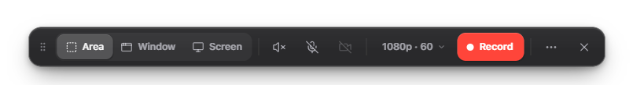
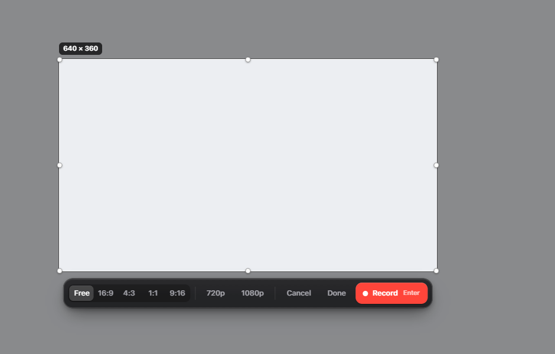
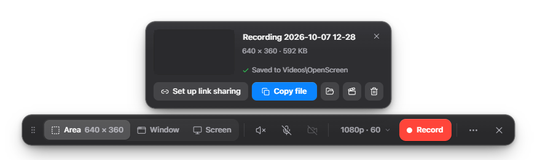
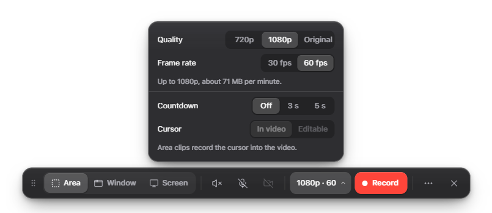
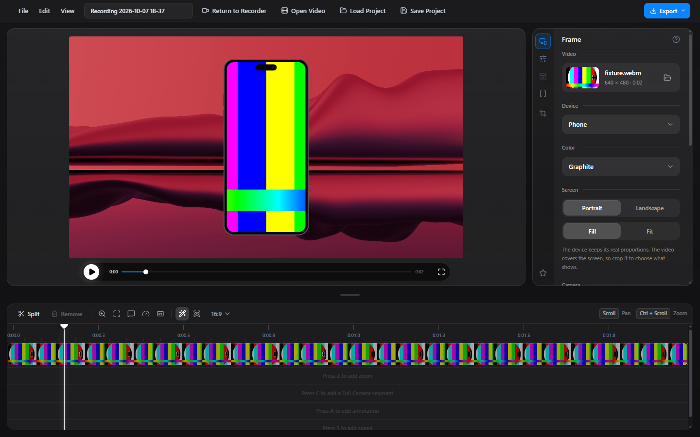
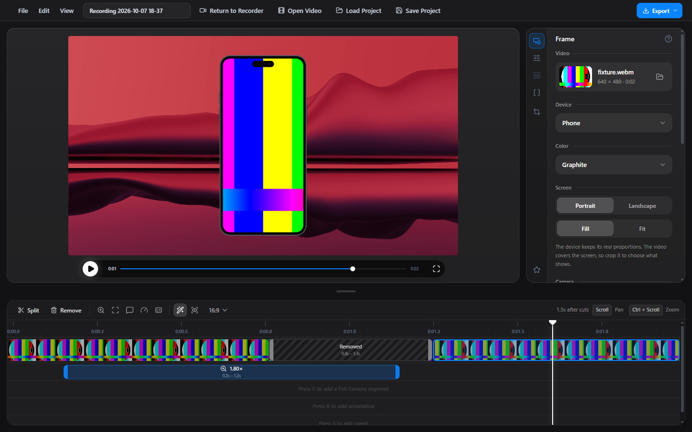
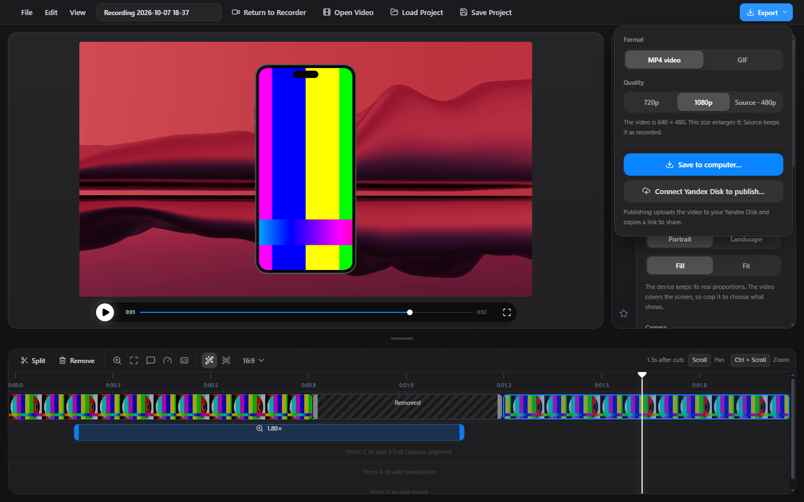
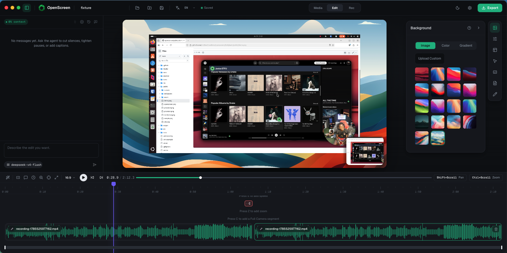

> [!IMPORTANT]
> **OpenScreen Creator Edition** is maintained by [@Likemiens](https://github.com/Likemiens). It is a public, forkable creator-focused distribution built on top of upstream OpenScreen. Issues, forks, and contributions are welcome.

> [!NOTE]
> This repository is an independent continuation of OpenScreen.
>
> OpenScreen was originally created by [Siddharth Vaddem](https://github.com/siddharthvaddem). The original repository was archived after v1.5.0 and remains available here: [siddharthvaddem/openscreen](https://github.com/siddharthvaddem/openscreen).
>
> This fork continues development under the OpenScreen name with the original author's approval, while remaining fully MIT open source.

> [!WARNING]
> OpenScreen is not production-grade software. You should expect bugs, rough edges, and occasional breaking changes.

<p align="center">
  
</p>

# <p align="center">OpenScreen Creator Edition</p>

<p align="center"><strong>OpenScreen is a free, open-source tool for creating polished screen recordings, product demos, and walkthroughs.</strong></p>

<p align="center">
  <a href="https://github.com/Likemiens/openscreen/blob/creator-edition/LICENSE"></a>
  <a href="https://github.com/Likemiens"></a>
  <a href="https://github.com/Likemiens/openscreen/actions/workflows/ci.yml"></a>
  <a href="https://discord.gg/VvT6Vtnyh"></a>
  
</p>


OpenScreen was originally positioned as a free, open-source alternative to Screen Studio: something you can use to create quick, polished product demos and walkthroughs for X, Reddit, YouTube, documentation, landing pages, or internal demos.

It is not a 1:1 clone of Screen Studio. Screen Studio is an excellent commercial product. OpenScreen focuses on covering the core open-source workflow: recording, zooms, cursor effects, webcam overlay, captions, editing, annotations, and export.

The goal of this continuation is to keep OpenScreen alive as a fully open-source project and progressively evolve it toward a broader recording and editing workflow.

**100% free** for both **personal** and **commercial** use. Use it, modify it, distribute it. Please respect the license.

> [!NOTE]
> Software should be accessible. OpenScreen has no paid tiers, premium features, upsells, or functionality locked behind a paywall.

## What Creator Edition Adds

The default [`creator-edition`](https://github.com/Likemiens/openscreen/tree/creator-edition) branch keeps the upstream recorder and Studio editor intact, and puts one job in front of everything else: **record a short clip of part of the screen, have it saved, and send it to someone.**

<p align="center">
  
</p>

### Quick clips

1. Press the record hotkey (or click **Record**). The area picker appears with your last area already drawn.
2. Drag out the area, or press <kbd>Enter</kbd> to reuse the previous one.
3. Press the hotkey again to stop. A second or two later the MP4 is in your clips folder, and a card offers **Copy link**, **Copy file**, **Show in folder**, **Edit in Studio**, or dragging the clip straight into a chat.

<p align="center">
  
</p>
<p align="center">
  
</p>

- **Area, window or screen capture.** The area picker supports free, 16:9, 4:3, 1:1 and 9:16 selections, exact 720p and 1080p sizes, moving, resizing and keyboard nudging. It shows the size in real pixels, and the selection is outlined while it records (the outline never ends up in the video).
- **Quality is chosen before you record.** 720p, 1080p or Original, at 30 or 60 fps, with an estimate of megabytes per minute. The recording is made at that frame rate, and the setting is remembered.
- **Saved the moment you stop.** A clip that needs no crop or resize is saved as recorded, without re-encoding. Anything else gets a single hardware crop/scale pass that takes a second or two for a short clip, instead of a full render in the editor. Bitrates are tuned for screen content, so files are small enough to send.
- **One hotkey from anywhere.** OpenScreen stays in the tray after you close the recorder. The hotkey starts a capture and stops the one in progress. It defaults to <kbd>Win</kbd>+<kbd>Shift</kbd>+<kbd>R</kbd> where that is free; Windows 11 reserves it for the Snipping Tool, so on most PCs it becomes <kbd>Ctrl</kbd>+<kbd>Alt</kbd>+<kbd>R</kbd>. Change it under **⋯ → Record shortcut**.
- **Light when idle.** A hidden recorder gives its window back after a minute; only the tray icon and the hotkey remain, and the recorder is rebuilt with your last setup when you need it. Optional **Launch at login** starts straight into the tray.
- **Two ways out of the app, both kept.** Every clip is saved to your own folder (default `Videos\OpenScreen`, changeable). **Copy link** uploads that same file to Yandex Disk, verifies it, publishes a file-specific link and copies it. Sharing never deletes a clip from your folder.

<p align="center">
  
</p>

### Studio recordings

Turn on the camera or switch the cursor to **Editable** (window and screen captures) and the recording keeps its separate tracks for Studio instead of being saved instantly. Stop then opens the export step: **Save anywhere**, **Edit in Studio**, or **Publish & get link**, each rendering the final MP4 with your cursor and camera.

### Studio: frame it, cut it, export it

Studio opens on a **Frame** tab that decides how the video is presented. Below it, the timeline shows the video as one clip you can cut; **Export** is one button at the top.

<p align="center">
  
</p>

- **Device mockups at real proportions.** Put the video inside a **phone** (9:19.5), a **tablet** (11-inch iPad), a **laptop** (16:10) or a **browser window**, in graphite, silver, black or white. A device never stretches to suit the video: **Scale** sizes it as a whole, a phone or tablet can be turned **Portrait** or **Landscape**, and the video either **fills** its screen (cropped to it) or **fits** inside it. A phone can carry a Dynamic Island, punch hole, notch or no camera. Only the browser window, which has no standard size, takes the shape of the video. The preview and the exported MP4/GIF draw the same device.
- **Aspect ratio in one click.** Auto, 16:9, 4:3, 1:1 and 9:16 sit next to the **Scale** slider.
- **Crop by the pixel.** Type how many source pixels to take off the **Top**, **Bottom**, **Left** and **Right** — `5` means exactly five — and see the resulting size. **Adjust on video** opens the visual crop editor, which shows the same numbers.
- **Background** is the last section of the same tab: 167 built-in wallpapers, your own image, a colour or a gradient.
- **Bring your own video.** **Open Video** in the title bar, the folder button on the Frame tab, dropping a file onto the empty editor, or **⋯ → Edit a video file…** in the recorder all open any MP4, MOV, WebM, MKV or AVI. Studio does not need a recording made by OpenScreen.

<p align="center">
  
</p>

- **One clip, cut where you like.** The first row of the timeline is the video itself, shown as a strip of its frames. Put the playhead where you want a cut and press **Split** (<kbd>T</kbd>); click a piece to select it and press **Remove** (<kbd>Delete</kbd>). The removed part stays on the track, hatched, so its edges can still be dragged and **Restore** puts it back. The toolbar shows how long the video is after the cuts. Zooms, camera, annotations and speed sit in their own rows underneath.
- **Export from one place.** **Export** (top right) asks what to render — MP4 at 720p, 1080p or the source size, or a GIF — and then where it goes: **Save to computer…**, or **Publish & copy link** to Yandex Disk. If Yandex Disk is not connected yet, the same menu connects it without leaving Studio.

<p align="center">
  
</p>

Creator Edition also includes:

- **A capture-safe recorder** that stays on screen while recording but is excluded from the video, with a timer and stop, pause, restart and delete.
- **Recording presets** (under **⋯**) that restore microphone, camera, system audio, cursor mode, countdown, quality, frame rate and a saved source in one click.
- **Yandex Disk publishing** with an encrypted token, verified uploads, upload progress and a system notification when the link is ready.
- **Safe local cleanup** as an option for Studio exports: local files are removed only after the upload is verified.
- **OpenScreen desktop branding** across the installed application, shortcuts, icons, notifications and Windows processes.

> [!IMPORTANT]
> Creator-focused changes live in `creator-edition`, while `main` stays aligned with [getopenscreen/openscreen](https://github.com/getopenscreen/openscreen). Upstream updates are synced into `main` first and then merged into `creator-edition`, keeping this distribution upgradeable without mixing its features into the upstream mirror.

> [!NOTE]
> Quick clips use the native recorder on Windows and macOS. Area clips always record the system cursor into the video and cannot include the camera; use a window or screen capture for those. On Linux, closing the last window still quits the app, because tray support varies between desktops.

<p align="center">
	
  
</p>

## Core Features
- Record a selected area, a specific window, or your whole screen.
- Record microphone and system audio.
- Webcam overlay with picture-in-picture, drag-to-position, mirroring, and shape options.
- Auto or manual zooms with adjustable depth, duration, easing, and pixel-precise position; auto-zoom follows your cursor as you work.
- Custom cursor size, smoothing, and click effects, with cursor themes and post-recording path smoothing.
- Automatic captions for voiceovers, generated on-device with no upload (works offline).
- Wallpapers, solid colors, gradients, or your own background image.
- Motion blur.
- Crop (visually or by exact source pixels), trim, and per-segment speed control on the timeline.
- Device mockups at real proportions — phone, tablet, laptop, browser window — and one-click aspect ratios.
- A clip track you can split into pieces and cut parts out of.
- Open any video file in the editor, not only OpenScreen recordings.
- Text, arrow, and image annotations, with text animation presets.
- Timeline snapping guides and an audio waveform to make trimming easier.
- Customizable keyboard shortcuts.
- Export to MP4 or GIF in multiple aspect ratios and resolutions.
- Languages supported: Arabic, English, Spanish, French, Italian, Japanese, Korean, Portuguese (Brazil), Russian, Turkish, Vietnamese, Simplified Chinese, and Traditional Chinese.


## Installation

Download the latest installer for your platform from the [GitHub Releases](https://github.com/EtienneLescot/openscreen/releases) page.

### macOS

Download the `.dmg` installer directly from the [Releases page](https://github.com/EtienneLescot/openscreen/releases). If Gatekeeper blocks the app, you can bypass it by running the following command in your terminal after installation:

```bash
xattr -rd com.apple.quarantine /Applications/Openscreen.app
```

Note: Give your terminal Full Disk Access in **System Settings > Privacy & Security** to grant you access and then run the above command.

After running this command, proceed to **System Settings > Privacy & Security** to grant the necessary permissions for "screen recording" and "accessibility". Once permissions are granted, you can launch the app.

> [!NOTE]
> **Upgrading from an older version and hitting permission issues?** If you already had OpenScreen installed and the new version won't record (Screen Recording or Accessibility keep failing even after you grant them), uninstall the old version, remove OpenScreen's existing entries under **System Settings > Privacy & Security** (both Screen Recording and Accessibility), then do a fresh install and grant the permissions again when prompted.

### Windows

Download the `.exe` installer directly from the [Releases page](https://github.com/EtienneLescot/openscreen/releases).

### Linux

Three packages are published to the [Releases page](https://github.com/EtienneLescot/openscreen/releases) for each version. Pick the one that matches your distro:

**Debian / Ubuntu / Pop!_OS (`.deb`)**
```bash
sudo apt install ./Openscreen-Linux-latest.deb
```

**Arch / Manjaro (`.pacman`)**
```bash
sudo pacman -U Openscreen-Linux-latest.pacman
```

**Any distro (`.AppImage`)**
```bash
chmod +x Openscreen-Linux-*.AppImage
./Openscreen-Linux-*.AppImage
```

**NixOS / Nix (flake)**

Try without installing:
```bash
nix run github:EtienneLescot/openscreen
```

Install into your user profile:
```bash
nix profile install github:EtienneLescot/openscreen
```

For a NixOS system config (flake):
```nix
{
  inputs.openscreen.url = "github:EtienneLescot/openscreen";

  outputs = { nixpkgs, openscreen, ... }: {
    nixosConfigurations.<host> = nixpkgs.lib.nixosSystem {
      modules = [
        openscreen.nixosModules.default
        { programs.openscreen.enable = true; }
      ];
    };
  };
}
```

For Home Manager, use `openscreen.homeManagerModules.default` with the same `programs.openscreen.enable = true;`.

You may need to grant screen recording permissions depending on your desktop environment.

**Sandbox error:** If the AppImage fails to launch with a "sandbox" error, run it with `--no-sandbox`:
```bash
./Openscreen-Linux-*.AppImage --no-sandbox
```

### Platform differences

Everything in the editor and export is the same on macOS, Windows, and Linux: zooms, backgrounds, motion blur, crop/trim/speed, blur regions, annotations, auto-captions, projects, export, and all languages. The differences are in **capture**, where macOS and Windows use a native pipeline that Linux doesn't have:

- **Native recording**: macOS (ScreenCaptureKit) and Windows (Windows Graphics Capture) record through a native pipeline for higher quality and clean window-level capture. Linux records through the browser pipeline instead.
- **Custom cursors**: on macOS and Windows the real cursor is captured (shape, type, and clicks), which powers the cursor themes, click effects, and editable cursor overlay. On Linux only the cursor position is captured (used for auto-zoom), so those cursor options aren't available.
- **Webcam**: captured natively on macOS and Windows; on Linux it's recorded through the browser, but still works as a picture-in-picture overlay.
- **System audio** support varies by OS:
  - **macOS**: requires macOS 13+. On macOS 14.2+ you'll be prompted to grant audio capture permission. macOS 12 and below can't capture system audio (mic still works).
  - **Windows**: works out of the box.
  - **Linux**: needs PipeWire (default on Ubuntu 22.04+, Fedora 34+). Older PulseAudio-only setups may not capture system audio (mic should still work).

## Building Creator Edition

```bash
npm install
npm run dev          # recorder + Studio with hot reload
npm run test         # unit tests
npm run build:win    # Windows installer in release/<version>/
```

`npm run build:win` first compiles the native Windows capture helper, which needs Visual Studio Build Tools with the C++ workload. If the prebuilt helpers are already in `electron/native/bin/win32-x64/`, the installer can be packaged without that toolchain:

```bash
npx tsc && npx vite build && npx electron-builder --win --config.npmRebuild=false
```

`npx playwright test tests/e2e/quick-clip.spec.ts` drives the real app on Windows: it selects an area, records a few seconds of the screen, and checks the saved clip. Run `npm run build-vite` first.

## Official links

This repository is the community-maintained continuation of OpenScreen.

Official / trusted links:

* Original archived repository: https://github.com/siddharthvaddem/openscreen
* Community continuation: https://github.com/EtienneLescot/openscreen

For safety, download OpenScreen only from the official GitHub Releases linked from this repository. Third-party websites using the OpenScreen name are not affiliated with this continuation unless explicitly listed here.

## Community

OpenScreen is community-driven. If you need help, want to report a bug, or just want to chat with other users and contributors:

- 💬 **Discord** — [Join the OpenScreen Discord](https://discord.gg/VvT6Vtnyh) for real-time help, showcase, and discussion
- 🐞 **[GitHub Issues](https://github.com/EtienneLescot/openscreen/issues)** — bug reports and feature requests
- 🗺️ **[Roadmap](./ROADMAP.md)** — see what we're building next

---

## License

This project is licensed under the [MIT License](./LICENSE). By using this software, you agree that the authors are not liable for any issues, damages, or claims arising from its use.

Wallpapers 19–167 in `public/wallpapers` come from the [Super Visuals — Backgrounds Library](https://www.figma.com/design/rd1wo2a08HDyumdphnNiqC/Super-Visuals--Backgrounds-Library) on Figma and remain under that library's own terms, not the MIT License.
