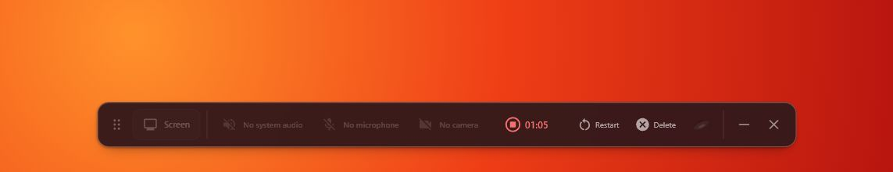

> [!IMPORTANT]
> **OpenScreen Creator Edition** is maintained by [@Likemiens](https://github.com/Likemiens). It is a public, forkable creator-focused distribution built on top of upstream OpenScreen. Issues, forks, and contributions are welcome.

> [!NOTE]
> This repository is an independent continuation of OpenScreen.
>
> OpenScreen was originally created by [Siddharth Vaddem](https://github.com/siddharthvaddem). The original repository was archived after v1.5.0 and remains available here: [siddharthvaddem/openscreen](https://github.com/siddharthvaddem/openscreen).
>
> This fork continues development under the OpenScreen name with the original author's approval, while remaining fully MIT open source.

> [!WARNING]
> OpenScreen is not production-grade software. You should expect bugs, rough edges, and occasional breaking changes.

<p align="center">
  
</p>

# <p align="center">OpenScreen Creator Edition</p>

<p align="center"><strong>OpenScreen is a free, open-source tool for creating polished screen recordings, product demos, and walkthroughs.</strong></p>

<p align="center">
  <a href="https://github.com/Likemiens/openscreen/blob/creator-edition/LICENSE"></a>
  <a href="https://github.com/Likemiens"></a>
  <a href="https://github.com/Likemiens/openscreen/actions/workflows/ci.yml"></a>
  <a href="https://discord.gg/VvT6Vtnyh"></a>
  
</p>


OpenScreen was originally positioned as a free, open-source alternative to Screen Studio: something you can use to create quick, polished product demos and walkthroughs for X, Reddit, YouTube, documentation, landing pages, or internal demos.

It is not a 1:1 clone of Screen Studio. Screen Studio is an excellent commercial product. OpenScreen focuses on covering the core open-source workflow: recording, zooms, cursor effects, webcam overlay, captions, editing, annotations, and export.

The goal of this continuation is to keep OpenScreen alive as a fully open-source project and progressively evolve it toward a broader recording and editing workflow.

**100% free** for both **personal** and **commercial** use. Use it, modify it, distribute it. Please respect the license.

> [!NOTE]
> Software should be accessible. OpenScreen has no paid tiers, premium features, upsells, or functionality locked behind a paywall.

## What Creator Edition Adds

The default [`creator-edition`](https://github.com/Likemiens/openscreen/tree/creator-edition) branch keeps the upstream recorder and Studio editor intact, while streamlining the workflow for quickly recording, naming, saving, editing, and sharing videos.

Compared with the upstream version, Creator Edition adds:

- **A capture-safe recording HUD** that remains visible while recording but is excluded from the captured video. It includes an elapsed-time counter and direct actions to stop, restart, pause when supported, or delete the current recording.
- **A cleaner creator-focused interface** with an English-only horizontal toolbar, live webcam preview, clearer device states, and the unused Notes, language picker, and vertical tray controls removed.
- **A post-recording launcher** that keeps the recording local first, lets you rename it, choose 720p, 1080p, or source quality and 30 or 60 FPS, then choose **Save Anywhere**, **Edit in Studio**, or **Publish & Get Link**.
- **Yandex Disk publishing** for the final rendered MP4. OpenScreen verifies the uploaded file, publishes a file-specific link, copies it to the clipboard, and shows a system notification when the video is ready.
- **Safe local cleanup** as an optional setting. Local files are deleted only after the remote upload has been verified; export or network failures keep the local recording intact.
- **OpenScreen desktop branding** across the installed application, shortcuts, icons, notifications, and Windows processes.

> [!IMPORTANT]
> Creator-focused changes live in `creator-edition`, while `main` stays aligned with [getopenscreen/openscreen](https://github.com/getopenscreen/openscreen). Upstream updates are synced into `main` first and then merged into `creator-edition`, keeping this distribution upgradeable without mixing its features into the upstream mirror.

<p align="center">
  
</p>

<p align="center">
	
  
</p>

## Core Features
- Record a specific window, or your whole screen.
- Record microphone and system audio.
- Webcam overlay with picture-in-picture, drag-to-position, mirroring, and shape options.
- Auto or manual zooms with adjustable depth, duration, easing, and pixel-precise position; auto-zoom follows your cursor as you work.
- Custom cursor size, smoothing, and click effects, with cursor themes and post-recording path smoothing.
- Automatic captions for voiceovers, generated on-device with no upload (works offline).
- Wallpapers, solid colors, gradients, or your own background image.
- Motion blur.
- Crop, trim, and per-segment speed control on the timeline.
- Text, arrow, and image annotations, with text animation presets.
- Timeline snapping guides and an audio waveform to make trimming easier.
- Customizable keyboard shortcuts.
- Export to MP4 or GIF in multiple aspect ratios and resolutions.
- Languages supported: Arabic, English, Spanish, French, Italian, Japanese, Korean, Portuguese (Brazil), Russian, Turkish, Vietnamese, Simplified Chinese, and Traditional Chinese.


## Installation

Download the latest installer for your platform from the [GitHub Releases](https://github.com/EtienneLescot/openscreen/releases) page.

### macOS

Download the `.dmg` installer directly from the [Releases page](https://github.com/EtienneLescot/openscreen/releases). If Gatekeeper blocks the app, you can bypass it by running the following command in your terminal after installation:

```bash
xattr -rd com.apple.quarantine /Applications/Openscreen.app
```

Note: Give your terminal Full Disk Access in **System Settings > Privacy & Security** to grant you access and then run the above command.

After running this command, proceed to **System Settings > Privacy & Security** to grant the necessary permissions for "screen recording" and "accessibility". Once permissions are granted, you can launch the app.

> [!NOTE]
> **Upgrading from an older version and hitting permission issues?** If you already had OpenScreen installed and the new version won't record (Screen Recording or Accessibility keep failing even after you grant them), uninstall the old version, remove OpenScreen's existing entries under **System Settings > Privacy & Security** (both Screen Recording and Accessibility), then do a fresh install and grant the permissions again when prompted.

### Windows

Download the `.exe` installer directly from the [Releases page](https://github.com/EtienneLescot/openscreen/releases).

### Linux

Three packages are published to the [Releases page](https://github.com/EtienneLescot/openscreen/releases) for each version. Pick the one that matches your distro:

**Debian / Ubuntu / Pop!_OS (`.deb`)**
```bash
sudo apt install ./Openscreen-Linux-latest.deb
```

**Arch / Manjaro (`.pacman`)**
```bash
sudo pacman -U Openscreen-Linux-latest.pacman
```

**Any distro (`.AppImage`)**
```bash
chmod +x Openscreen-Linux-*.AppImage
./Openscreen-Linux-*.AppImage
```

**NixOS / Nix (flake)**

Try without installing:
```bash
nix run github:EtienneLescot/openscreen
```

Install into your user profile:
```bash
nix profile install github:EtienneLescot/openscreen
```

For a NixOS system config (flake):
```nix
{
  inputs.openscreen.url = "github:EtienneLescot/openscreen";

  outputs = { nixpkgs, openscreen, ... }: {
    nixosConfigurations.<host> = nixpkgs.lib.nixosSystem {
      modules = [
        openscreen.nixosModules.default
        { programs.openscreen.enable = true; }
      ];
    };
  };
}
```

For Home Manager, use `openscreen.homeManagerModules.default` with the same `programs.openscreen.enable = true;`.

You may need to grant screen recording permissions depending on your desktop environment.

**Sandbox error:** If the AppImage fails to launch with a "sandbox" error, run it with `--no-sandbox`:
```bash
./Openscreen-Linux-*.AppImage --no-sandbox
```

### Platform differences

Everything in the editor and export is the same on macOS, Windows, and Linux: zooms, backgrounds, motion blur, crop/trim/speed, blur regions, annotations, auto-captions, projects, export, and all languages. The differences are in **capture**, where macOS and Windows use a native pipeline that Linux doesn't have:

- **Native recording**: macOS (ScreenCaptureKit) and Windows (Windows Graphics Capture) record through a native pipeline for higher quality and clean window-level capture. Linux records through the browser pipeline instead.
- **Custom cursors**: on macOS and Windows the real cursor is captured (shape, type, and clicks), which powers the cursor themes, click effects, and editable cursor overlay. On Linux only the cursor position is captured (used for auto-zoom), so those cursor options aren't available.
- **Webcam**: captured natively on macOS and Windows; on Linux it's recorded through the browser, but still works as a picture-in-picture overlay.
- **System audio** support varies by OS:
  - **macOS**: requires macOS 13+. On macOS 14.2+ you'll be prompted to grant audio capture permission. macOS 12 and below can't capture system audio (mic still works).
  - **Windows**: works out of the box.
  - **Linux**: needs PipeWire (default on Ubuntu 22.04+, Fedora 34+). Older PulseAudio-only setups may not capture system audio (mic should still work).

## Official links

This repository is the community-maintained continuation of OpenScreen.

Official / trusted links:

* Original archived repository: https://github.com/siddharthvaddem/openscreen
* Community continuation: https://github.com/EtienneLescot/openscreen

For safety, download OpenScreen only from the official GitHub Releases linked from this repository. Third-party websites using the OpenScreen name are not affiliated with this continuation unless explicitly listed here.

## Community

OpenScreen is community-driven. If you need help, want to report a bug, or just want to chat with other users and contributors:

- 💬 **Discord** — [Join the OpenScreen Discord](https://discord.gg/VvT6Vtnyh) for real-time help, showcase, and discussion
- 🐞 **[GitHub Issues](https://github.com/EtienneLescot/openscreen/issues)** — bug reports and feature requests
- 🗺️ **[Roadmap](./ROADMAP.md)** — see what we're building next

---

## License

This project is licensed under the [MIT License](./LICENSE). By using this software, you agree that the authors are not liable for any issues, damages, or claims arising from its use.
